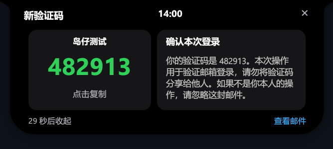
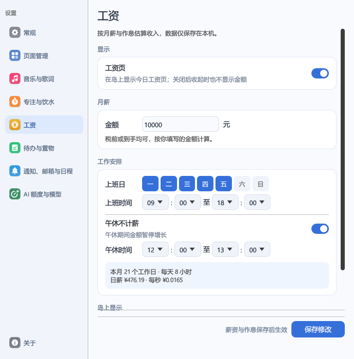

# 使用指南

## 第一次打开

鼠标靠近屏幕顶部的小岛会展开功能面板。左右箭头和底部圆点切换页面；在列表内部滚轮查看更多内容。托盘菜单可打开设置、控制开机启动或退出程序。

设置里的功能显示开关可以隐藏不常用的页面；隐藏页面不等于删除它的数据。

觉得岛太小时，在设置 → 常规 → 岛体显示 →「岛的大小」中放大到 110%–150%；只放大岛，设置和邮件等窗口保持原大小。倍数受屏幕尺寸限制，保证右侧通知不超出屏幕。

## 邮箱

在「设置 → 邮件」添加完整邮箱地址，选择服务商并填写授权码或 App 专用密码。不要把密码发送到聊天、Issue 或截图里。

| 邮箱 | 获取连接凭据 |
| --- | --- |
| QQ | QQ 邮箱网页版右上角「设置」→「账号与安全」→「安全设置」→「POP3/IMAP/SMTP/Exchange/CardDAV 服务」→开启服务并生成授权码 |
| 163／126 | 邮箱网页版「设置」→「POP3/SMTP/IMAP」→开启 IMAP，并按页面验证生成客户端授权密码 |
| 腾讯企业邮 | 网页版设置中的客户端收发设置；企业管理员可能限制 IMAP 或第三方客户端 |
| iCloud | Apple 账号开启双重认证后，在账号安全页面生成 App 专用密码 |
| Gmail | Google 账号开启两步验证后生成应用专用密码；单位账号可能由管理员禁用此入口 |

以服务商当前页面为准，岛仔设置页也提供对应说明和网页入口。Gmail 在部分网络环境下需要能够访问 Google；岛仔不会替你改变系统网络设置。

连接后读取最近 20 封邮件；运行期间列表最多保留 60 封。新邮件优先通过 IMAP IDLE 接收，并有定期防漏检查；不支持推送的邮箱按设置间隔检查，等待期间保持连接活跃。断线重连后会立即补收漏过的邮件，同步完成后才显示「已连接」。服务器、网络及服务商投递耗时仍会影响实际到达时间。

验证码卡片显示来源与主题，点击即可复制。点邮件列表进入详情，滚轮查看正文；「阅读全文」打开独立阅读窗口。正文内的网页链接交给默认浏览器打开。

开启邮箱页和「识别并显示验证码」后，新验证码同步到岛仔时会自动展开临时预览：左侧放大验证码，点击复制；右侧显示正文简介，30 秒后收起，保留原先看的页面。点击关闭或按 Esc 可提前收起，「查看邮件」进入正常邮件详情。再次收到新的验证码会更新预览并重新计时，同一封邮件重复同步不会延长时间。历史、已隐藏的旧验证码不触发预览；较短的隐私时限仍会提前结束预览。正在编辑、拖入文件或打开设置时不抢占当前操作。自动预览不依赖普通通知开关，实际收信延迟仍受邮箱检查间隔影响。

新邮件的验证码从岛仔首次收到时开始计算自动隐藏时长（默认 60 秒），同时受服务器收信年龄的 5 分钟上限约束：补收时已经收信满 5 分钟的验证码直接隐藏，显示期间达到这个上限也会隐藏。邮件明确声明的更短有效期仍从服务器收信时间扣除。历史邮件默认隐藏，重复收到同一封邮件不会重新计时；没有可用收信时间时沿用本机计时。隐藏不代表验证码已经失效，主动查看仍按原来的 15 秒窗口显示。

## 日程

在「设置 → 日程」选择平台，填写平台提供的 CalDAV 连接信息。只登录或安装飞书、钉钉、企业微信桌面客户端，不会自动授予岛仔日历读取权限。

- 左侧月历选择日期；右侧按时间显示日程，全天安排在前。
- 大卡片显示选中的日程；滚轮只滚动下方列表，点击其他条目切换大卡片。
- 跨天日程会出现在覆盖的日期中。结束时刻按日历提供的数据展示。
- 自动同步默认每 5 分钟进行；点击右上角更新时间可手动刷新月份。
- 提前提醒时间可在设置中选择 5／15／30 分钟；全天安排展示在日历中，不在午夜弹出会议提醒。
- 普通邮件正文中的日期不会加入日程；带日历附件的正式邀请会自动显示。
- 邮件日程右侧的 × 可忽略该日程，停止显示与提醒；在邮件详情或全文窗口选择「恢复日程」可恢复。忽略邮件来源不会删除工作日历中的对应安排。

**当前边界：** 邮件日程依赖当前加载的邮件记录，不是完整邮箱归档；复杂的批量重复规则修改可能提示不支持。日历同步失败会显示错误，不能把“已连接”当成所有日程都已成功同步。程序退出、电脑关机或睡眠期间无法持续接收提醒。

## 音乐、专注、饮水与待办

音乐来自 Windows 媒体会话，播放器需要提供系统媒体信息。歌词匹配依赖歌曲元数据和外部服务，个别版本、纯音乐或未找到歌词的歌曲可能无法显示同步歌词。

专注与休息需点击开始，结束后可进入下一阶段。饮水可设置目标、单次量、提醒间隔和时段；记录错误可以撤销。待办提醒是可选项，填写任务后通过日期／时间选择器设置，不需要手写时间格式。

## 工资

在设置 → 工资中打开「工资页」，填写月薪、上班日、上下班时间和午休时间后点「保存」。每秒收入 = 月薪 ÷（本月工作日数 × 每天计薪时长），工作日数按勾选的星期几计算，午休不计薪，所以本月最后一个工作日下班时正好赚满月薪。

上班时间内，岛上显示金币和今日金额，变化的数字逐位向上滚动；悬停在金额上展开时直接打开工资页，金币随每次入账跳一下。午休时金额暂停、变灰，下班后定格为今日总额，上班前和休息日不显示。岛上组件较多、放不下时，工资组件会暂时让位。暂不支持法定节假日调休、大小周、加班和跨午夜的夜班。

不想让别人看到金额时，可以关闭「收起时显示金额」，只在工资页查看。

工资设置底部的保存按钮和校验提示固定可见；内容超出窗口时，可沿右侧滚动条查看更多设置。

## 截图

按 `Alt + A`、点托盘「区域截图」或截图页右上角的「新截图」开始。屏幕会定格并变暗，拖动框选一个区域；一张截图只能在一块屏幕内。截图里不会出现岛本身。

松开鼠标后选区停住，不会立即保存：拖动四角和四边中点调整大小，按住选区中间整体移动，在选区外重新拖动就是重选。点「保存」、按 Enter 或双击选区保存；按 Esc、右键或点「取消」退出。

保存的截图是 PNG，放在 `E:\截图`，按月份分文件夹，只由你手动删除；同时复制到剪贴板，可直接粘贴。保存后岛会自动展开 8 秒显示刚截的图，鼠标移进去会保持展开。

截图页可以浏览全部历史：悬停时出现的左右箭头、方向键、滚轮、触控板左右滑或点缩略图切换；按住主图向下拖、或拖动缩略图，可以直接拖进聊天窗口、文档或资源管理器。下面的按钮可以查看原图、复制、打开所在文件夹，或把截图移入回收站。

在设置 → 截图中可以更换保存位置和快捷键（`Alt + A` / `Alt + S` / `Ctrl + Alt + A` / `F1` / 关闭）。快捷键对所有程序生效；`Alt + A` 也是微信的默认截图键，两个程序谁先启动谁生效，被占用时设置页会提示。

没有 E 盘、目录只读或磁盘已满时，截图不会丢：岛上会显示原因，可以重试、另选目录、复制图片或放弃。

## AI 额度

先登录相应工具，再在岛仔 AI 额度设置中识别本机账号。多个账号可分别命名、选择配色并决定是否常驻。Codex、Claude、Kimi 的本机登录由原工具管理，岛仔不会修改它们的配置。

Grok Bot、Gemini 提供各自的连接入口；会话过期时重新连接。额度接口、订阅类型和服务商策略可能变化，未识别或请求失败时应以对应服务的官方页面为准。

## 更新、卸载与数据目录

双击新版 `Daozai-Setup-v版本号-x64.exe`，可通过路径输入框或「浏览…」选择安装文件夹，勾选「创建桌面快捷方式」和「开机自启」，再点击「一键安装」。首次安装默认创建桌面快捷方式、不开机自启；升级默认保留现有选择。安装位置默认为 `%LOCALAPPDATA%\Programs\Daozai`，可改为其他有写入权限的文件夹，用户数据仍保存在 `%APPDATA%\Daozai`。

升级安装保留数据。若提示岛仔正在运行，先从托盘退出，再点击重试。

在 Windows 已安装应用中卸载会移除程序和快捷方式，但保留数据。若要清除账号，先在岛仔设置中移除对应连接，避免只删配置文件而留下系统凭据。

## 常见问题

**窗口没有出现：** 检查托盘是否已有实例、是否在全屏应用中、设置是否启用了全屏隐藏。

**邮箱登录失败：** 确认填的是授权码／App 专用密码、IMAP 已启用、账号没有被管理员限制。

**日程连接成功但没有安排：** 手动同步所选月份，确认平台授权的日历包含该日程；出现错误时保留错误文字即可，不要提供密码。

**验证码没有马上出现：** 确认邮件是否已到达收件箱，而非垃圾箱；检查岛仔是否运行、连接是否正常。

**图标或布局异常：** 反馈 Windows 版本、屏幕缩放比例、显示器数量和截图。截图先遮挡账号、验证码及私人日程。
