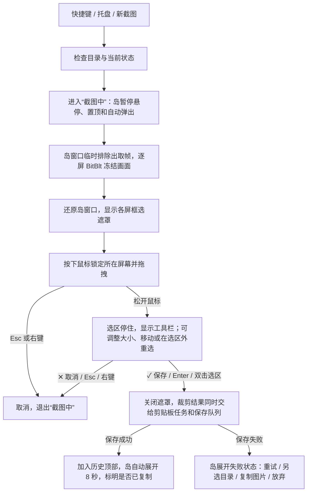

# 岛仔截图与截图图库设计

| 项目 | 内容 |
| --- | --- |
| 文档版本 | v0.5：功能已实现，第 11 节记录实现时相对设计的调整（v0.1 备份于 `E:\tmp\lingdongdao-notes\screenshot-gallery-v0.1.md`） |
| 日期 | 2026-11-06，Asia/Shanghai |
| 代码基线 | `main` / `4fd41b1`，Rust + eframe/egui（glow），Windows 10/11 x64 |
| 本轮交付 | 产品交互、存储规则、技术方案、工作量与验收标准；尚未实现功能 |
| 工作量判断 | 中等规模；可演示主流程约 2 人日，完整第一版和回归约 6–8.5 人日，前者包含在后者中 |

## 0. v0.2 修订摘要

产品需求（第 1 节）不变。修改集中在存储和截图实现：v0.1 的存储层按数据库思路设计，实际只需要一个图片文件夹；部分技术判断与现有代码不符。

| # | v0.1 | v0.2 | 原因 |
| --- | --- | --- | --- |
| 1 | 每张图一份 JSON 记录，`pending/ready/deleting` 状态机，`library_id`，写入锁，`.daozai` 数据目录 | **截图文件夹本身就是历史**：启动时扫描文件名并排序，不另存记录 | 记录与图片双写会出现“图片在、记录不在”等不一致，v0.1 用了半节篇幅修补；只存文件就不会不一致，外部删掉的图自然从列表消失 |
| 2 | 截图前隐藏岛、设置窗口、邮件窗口，等 DWM 合成后再取帧，结束后恢复 | 取帧时把**岛窗口**临时设为 `WDA_EXCLUDEFROMCAPTURE`，取完立即还原；设置、邮件窗口照常可截 | 不闪烁，不依赖 sleep，也不会出现“恢复了本来就隐藏的窗口”；用户可能就是想截设置或邮件窗口 |
| 3 | 未考虑截图过程中岛的悬停 | 新增“截图中”状态：暂停悬停展开、置顶和自动弹出 | 岛靠轮询 `GetCursorPos` 判断悬停（[main.rs:520](../../src/main.rs)），展开时会 `SetWindowPos(HWND_TOPMOST)`（[native.rs:181](../../src/native.rs)）。框选时鼠标经过屏幕顶部，岛会展开并盖到遮罩上 |
| 4 | 热键放在 [input.rs](../../src/input.rs) 旁 | 在 [tray.rs](../../src/tray.rs) 已有的隐藏窗口线程上 `RegisterHotKey`，处理 `WM_HOTKEY` | 托盘线程已有窗口、消息循环和到主线程的事件通道；input.rs 只是输入法检测钩子 |
| 5 | “注册失败显示冲突，不替换别的软件快捷键” | 更正：`RegisterHotKey` 只能发现与**其他全局热键**的冲突；程序内部快捷键会被静默抢走 | 例如 JetBrains 的 `Ctrl+Alt+S` 是打开设置，注册后 IDE 再也收不到这个组合键 |
| 6 | 自己写 `CF_DIB` 剪贴板代码 | 在工作线程调用 `arboard` 的 `set_image`（同时写入 `CF_DIBV5` 和 PNG） | arboard 3.7 已经通过 egui-winit 带 `image-data` 编译进程序，加成直接依赖也不会引入新 crate。不用 egui 的 `ctx.copy_image`：它在 UI 线程编码 PNG，失败只写日志 |
| 7 | 删除只写“移入回收站，失败不降级” | 用 `FOF_ALLOWUNDO` 时**必须同时加** `FOF_WANTNUKEWARNING` | 如果目标盘关闭了回收站，或文件超出回收站容量，只设 `FOF_ALLOWUNDO` 会静默永久删除 |
| 8 | 自动预览要记录原页面，结束后恢复 | 与邮件验证码预览相同，做成覆盖层，不修改 `self.page`。截图预览与邮件预览各用一个 `Option`，按优先级绘制，不重构成统一入口 | 现有 [mail_preview.rs](../../src/mail_preview.rs) 已证明这种做法可行，测试也覆盖了“预览不改原页面”；不需要改动已上线的邮件预览代码 |
| 9 | 128 MiB WebP 磁盘缩略图缓存，按最近使用淘汰 | 第一版缩略图只放内存，按需从 PNG 解码 | 缩略图条一次只显示约 5 张；以后实测确实慢再加磁盘缓存 |
| 10 | 另一个实例占用时只读展示 | 删除 | 已有单实例互斥量 `Local\DaozaiFork.SingleInstance`（[tray.rs:53](../../src/tray.rs)） |
| 11 | 编码保存期间不能开始下一次截图 | 允许连续截图，保存任务串行排队 | 连续截图是常见用法；岛窗口不会出现在截图里，不存在截到上一张预览的问题 |
| 12 | 方向键、滚轮规则没有提到与现有行为冲突 | 明确截图页**覆盖**现有“左右键、滚轮翻页”（[app.rs:1339](../../src/app.rs) 起）；缩略图条跟随选中项居中，不单独滚动 | 不改的话，在图库里按方向键或滚轮会跳到别的功能页 |

## 1. 已确认的需求

以下选择均已由用户明确确认。标注 v0.3 的四项是用户对 v0.2 第 10 节的答复。

| 需求 | 第一版行为 |
| --- | --- |
| 截图方式 | 鼠标拖拽框选矩形区域 |
| 截图范围 | 可在任意显示器截图；一张截图限于一个显示器 |
| 截图内容（v0.3） | 不包含岛本身；设置窗口和邮件窗口照常可截 |
| 默认热键（v0.3） | `Alt + A` |
| 保存方式 | 自动保存到 `E:\截图`，由用户手动删除 |
| 剪贴板（v0.3） | 每次截图完成后**自动复制到剪贴板** |
| 截图成功反馈 | 保存成功后自动展开岛，展示刚保存的截图 |
| 展开时长 | 默认 8 秒；鼠标进入后保持展开，离开后收起 |
| 多图浏览 | 多张截图可以左右滑动、选择 |
| 历史记录 | 重启后仍能浏览全部截图历史 |
| 图片操作 | 预览、复制图片、打开文件夹、删除 |
| 拖出（v0.3） | 可以把截图从岛上直接拖到聊天窗口、文档或资源管理器 |
| 确认（v0.4） | 松开鼠标后选区停住并显示工具栏「✕ 取消」「✓ 保存」；可以拖动边和角调整大小、拖动选区中间整体移动；Enter 或双击选区保存，Esc 或右键取消 |

第一版不包含画笔、箭头、文字、马赛克、OCR、滚动长截图、窗口自动吸附、跨屏拼接、监听其他截图工具或自动导入剪贴板图片。

## 2. 产品形态与入口

新增独立的「截图」功能页，沿用岛仔现有皮肤、展开动画和页面设置。截图文件由截图图库管理，现有置物架仍然只收藏文件路径。

| 入口 | 设计 |
| --- | --- |
| 全局快捷键 | 默认 `Alt + A`（`MOD_ALT | MOD_NOREPEAT` + `A`）。设置里提供下拉预设，至少包含 `Alt + A`、`Alt + S`、`Ctrl + Alt + A`、`F1` 和「关闭」，不做自由录制按键控件。注册失败时提示“`Alt + A` 已被其他程序占用（常见是微信截图）”，并引导用户改选 |
| 截图页按钮 | 右上角「新截图」；图库为空时显示明显的「开始截图」按钮 |
| 托盘菜单 | 增加「区域截图」；岛因全屏或极简策略不可见时仍可使用 |
| 历史入口 | 功能页导航中的「截图」 |

只注册这一个全局热键，不常驻采集屏幕，也不监听剪贴板。设置页需注明：热键对所有程序生效，会覆盖其他程序内部的同名快捷键。

`Alt + A` 也是微信电脑版默认的截图热键，两者谁先注册谁生效：微信先启动，岛仔注册失败并提示；岛仔先启动（例如开机自启），微信会提示自己的热键冲突。若想两个都用，需在微信或岛仔中改掉一个。

## 3. 一次截图的完整流程



| 阶段 | 具体规则 |
| --- | --- |
| 开始 | 重复触发热键不会创建第二个遮罩；存在未处理的保存失败图片时，不开始新截图，而是重新展开失败状态 |
| 截图中 | 岛不根据光标位置展开，不调用置顶，邮件和提醒的自动弹出推迟到截图结束；已展开的岛立即收起（岛不会被截入，所以不需要等收起动画） |
| 取帧 | 岛窗口设为 `WDA_EXCLUDEFROMCAPTURE` → `DwmFlush` → 每个屏幕各 BitBlt 一次 → 立即还原为 `WDA_NONE`。只在这一瞬间排除，避免岛在用户的会议共享或录屏里消失 |
| 选择 | 各屏显示冻结画面和半透明遮罩；十字光标、选区边框、物理像素尺寸；不把鼠标光标画进图片 |
| 单屏约束 | 第一次按下鼠标时锁定所在屏幕；拖出该屏时，选区限制在屏幕边界内 |
| 调整（v0.4） | 松开鼠标后选区停住，不立即保存。选区四角和四边中点显示控制点：拖边或角调整大小（拉过对边时自动翻转），按住选区内部拖动整体移动，移动和调整都限制在锁定的屏幕内；在选区外按下就是在所按的屏幕上重新框选。光标随位置变成对应的调整、移动或十字形状；尺寸读数实时更新 |
| 工具栏（v0.4） | 位于选区下方并右对齐；下方放不下时放到上方，上下都放不下时放进选区右下角内侧。两个按钮「✕ 取消」「✓ 保存」，大小随 DPI 缩放，按下和松开都在按钮上才算点击；调整或移动选区时工具栏跟着移动 |
| 完成 | 点「✓ 保存」、按 Enter，或双击选区内部，才开始保存；没有画笔等编辑功能。宽或高小于 2 个物理像素时不能保存（保存按钮置灰，Enter 无效），可以继续调整或重选 |
| 自动复制 | 确认保存后，在工作线程把内存中的裁剪结果交给 `arboard` 写入剪贴板，不等 PNG 保存完成；保存失败也不影响复制。剪贴板被占用时短暂重试几次，仍失败就在预览中显示「未能复制，点击重试」，不阻塞保存和预览 |
| 取消 | 框选中、调整中都可以用 `Esc`、右键或「✕ 取消」退出整个截图；不产生文件，不改剪贴板 |
| 结束 | 拿到裁剪结果后立即关闭遮罩、释放冻结画面、退出“截图中”，不等 PNG 编码完成 |
| 连续截图 | 上一张还在编码时可以开始下一张；保存队列串行执行，每张保存成功后都展示最新一张，8 秒重新计时 |

取消、取帧失败、显示器变化和程序退出都走同一个清理出口：关闭遮罩，释放鼠标捕获，还原岛的取帧属性，退出“截图中”。

## 4. 展开预览与多图浏览

### 4.1 版式

截图页使用 **419 × 246 逻辑点**：宽度与现有面板一致，加高本页。现有最高的页面是邮件详情的 236（[app.rs:1221](../../src/app.rs)），透明画布高 270，需要确认阴影不被裁切。面板底部圆角半径为 33，底行按钮要内缩。

```text
┌──────────────────────────────────────────────┐
│ 截图              1 / 59       新截图    ×   │
│                                              │
│  ‹          当前截图，完整等比显示         ›  │
│                                              │
│    [缩略图] [缩略图] [当前] [缩略图] [缩略图]  │
│                                              │
│ 查看原图    复制图片    打开文件夹    删除      │
│                 功能页导航                   │
└──────────────────────────────────────────────┘
```

接交互之前，先参照 `salary_layout_gallery` 写一个 ignored 测试，渲染空图库、横图、竖图、窄长图、文件缺失和保存失败几种版式的 PNG，由用户确认后再继续。

| 区域 | 行为 |
| --- | --- |
| 主预览 | 完整显示，保持比例，不裁切；横图、竖图和窄长图都居中留白 |
| 左右箭头 | 只切换截图；到头时禁用，不循环 |
| 缩略图条 | 以当前选中项为中心，显示前后各 2 张；点击选中。缩略图条不单独滚动 |
| 图片计数 | 最新的在最前，`1 / N` 就是最新一张 |
| 查看原图 | 点击按钮或双击图片，用 Windows 默认图片查看器打开 |
| 空图库 | 显示「还没有截图」和「开始截图」 |
| 正在读取 | 启动后首次扫描未完成时显示「正在读取截图…」 |

### 4.2 输入归属

| 操作 | 行为 |
| --- | --- |
| 按住主图横向拖 | 向左是下一张（更早），向右是上一张（更新） |
| 按住主图向下拖 | 拖出：开始系统文件拖放，可放到聊天窗口、文档或资源管理器。岛在屏幕顶部，往下拖就是往外拖 |
| 按住缩略图拖动 | 任意方向都是拖出对应的截图；单击仍是选中 |
| 触控板水平滑动 | 读取 `raw_scroll_delta.x` 并累积；一次手势最多切一张，停顿约 0.25 秒后才接受下一次 |
| 图库区内的鼠标滚轮 | 一格切一张（向下更早）；到头后**不**翻到其他功能页 |
| 方向键 | 在截图页覆盖现有的“左右键翻页”，改为切图 |
| 点击缩略图 | 直接选中 |
| 切换功能页 | 通过底部导航点，或在标题栏区域滚动 |

主图拖动的方向只判定一次：位移达到 12 逻辑点时，向下且纵向位移不小于横向的，进入拖出；横向位移大于纵向 1.5 倍的，进入切图，松开时横向累计超过 32 逻辑点才切换。之后本次拖动不再改变方向。这些阈值需在真机上调整。被识别为拖动后，不再触发单击或双击。自动弹出不抢其他程序的键盘焦点。

拖出直接复用置物架的 `Cmd::DragFile` → `system::drag_file`（`SHDoDragDrop`，只允许 `DROPEFFECT_COPY`），所以原文件不会被移走，图库也不变。只有已保存的截图能拖出，保存失败状态下不能拖。拖放结束后，如果光标已在岛外，预览按正常规则收起。

### 4.3 自动展开的定义

做法与 `mail_preview` 相同：使用 `screenshot.preview: Option<Preview>` 覆盖层，绘制时优先于当前页面，不修改 `self.page`。

1. 保存成功后，创建预览并选中新截图，`until = t + 8`。
2. 用户没有进入岛：到时间收起。
3. 用户进入岛：清除 `until`，保持展开；离开后沿用现有 `LEAVE_DELAY`（0.12 秒）收起并结束预览。
4. 拖动切图、删除确认期间保持展开；`×` 立即收起；`Esc` 只在岛有键盘焦点时生效。
5. 每次新截图成功都会替换当前预览，重新计时。
6. 预览结束后，下次悬停仍然打开用户原来的页面。预览中的选中项与截图页共用，所以之后进入截图页时停在同一张。
7. 预览期间收到验证码：照常写入 `mail.preview`，计时照常进行，但先绘制截图预览；截图预览结束时，如果验证码预览还没过期，就直接显示，岛不收起。

## 5. 保存与历史

### 5.1 目录布局

```text
E:\截图\
├─ 2026-11\
│  ├─ 截图_20261106_153012_328.png
│  ├─ 截图_20261106_153012_328_1.png      # 同一毫秒重名时追加序号
│  └─ 截图_20261106_153018_605.png
└─ 2026-12\
```

不建立隐藏数据目录，不存放额外的元数据文件。

| 规则 | 内容 |
| --- | --- |
| 什么算历史 | 根目录下一层月份文件夹中，文件名符合 `截图_YYYYMMDD_HHMMSS_mmm[_n].png` 的文件。用户自己放进来的其他图片不显示，也就不会被误删 |
| 排序 | 按文件名中的时间倒序；不看修改时间（复制文件会改变修改时间） |
| 启动 | 后台线程扫描（`read_dir` 只列目录不读图片，1 万个文件应在几十毫秒内完成，需实测）；不进入目录联接或符号链接 |
| 尺寸 | 解码时才读取，不预先保存 |
| 外部删除或移动 | 每次打开截图页时后台重新扫描；加载某张图时发现文件不存在，就从列表中去掉。不显示失效占位，也不需要“移除失效记录” |
| 缩略图 | 只存内存，见 7.6 |
| 原始截图 | 无损 PNG；只由用户手动删除，不按天数、数量或容量自动清理 |
| 目录设置 | 首次使用时，如果 `E:\` 存在就用 `E:\截图`；否则提示选择目录。之后可在设置里更改为其他绝对路径 |
| 更换目录 | 重新扫描新目录，不搬动也不删除旧目录的文件，切回旧目录即可看到原有历史。已排队的保存任务带着发起时的目标目录，不会写进新目录 |
| 目录不可用 | 盘符不存在、无权限或空间不足时明确报错并允许另选目录；**不自动改存** C 盘、系统临时目录或“图片”文件夹 |
| 少量配置 | 热键、目录等设置沿用岛仔现有配置文件 |

现有音乐、邮件等功能的数据目录不在本次范围内。Windows 剪贴板历史、分页文件、资源管理器缓存和回收站由系统管理，本方案只约束岛仔主动写入的截图文件。

### 5.2 写入

| 步骤 | 操作 |
| --- | --- |
| 1 | 用本地时间生成文件名，用 `OpenOptions::create_new` 创建同目录下的 `<最终名>.part`；已存在就追加 `_1`、`_2` |
| 2 | 编码 PNG 写入后关闭文件；使用 `CompressionType::Fast`，编码速度明显快于默认级别，文件稍大 |
| 3 | `MoveFileExW(part, final, MOVEFILE_WRITE_THROUGH)`，**不加** `MOVEFILE_REPLACE_EXISTING`。不能用 `std::fs::rename`，它在 Windows 上会覆盖同名文件 |
| 4 | 成功后通知 UI 插入列表顶部；失败时删除 `.part`，内存中的图片进入失败状态 |
| 中断 | 如果进程在写入过程中退出，只会留下 `.part`；下次启动扫描时删除符合本功能命名的 `.part`。最终的 `.png` 要么完整，要么不存在 |

失败状态最多保留一张图片，提供「重试」「另选目录」「复制图片」「放弃」。截图已经自动复制过一次；保留「复制图片」，是为了剪贴板内容被覆盖后，用户仍能在盘符丢失时拿走这张截图。退出程序时如果还有未保存的图片，要明确提示。

### 5.3 复制与删除

| 操作 | 规则 |
| --- | --- |
| 自动复制 | 见第 3 节。会覆盖截图前的剪贴板内容；开启 Windows 剪贴板历史（`Win + V`）时，每张截图也会进入系统的剪贴板历史，由系统管理 |
| 复制图片 | 用于复制历史中的其他截图：点击后在工作线程解码原图，交给 `arboard` 写入剪贴板；返回成功后才提示「已复制图片」，失败时提示原因 |
| 拖出 | 见 4.2；只复制，不移动原文件 |
| 打开文件夹 | 复用现有 `Cmd::Reveal`（`explorer /select,`）；文件不存在时打开月份目录 |
| 删除 | 确认文案「将此截图移入回收站？」；在工作线程调用 `SHFileOperationW(FO_DELETE, FOF_ALLOWUNDO | FOF_WANTNUKEWARNING | FOF_NOCONFIRMATION)`；成功后从列表移除，选中相邻的一张 |
| 无法进回收站 | 由 `FOF_WANTNUKEWARNING` 弹出系统询问，用户拒绝就保留文件；不会静默永久删除 |
| 删除前校验 | 规范化后的路径必须位于当前根目录的月份子目录内，文件名符合本功能命名；删除按路径执行，不按列表下标，避免快速切图时删错 |

## 6. 与岛上其他功能的关系

| 场景 | 行为 |
| --- | --- |
| 音乐与歌词正在显示 | 截图预览暂时覆盖；播放状态照常刷新，预览结束后恢复 |
| 正在编辑待办或日程 | 允许截图，草稿保留。保存成功后不弹出预览，只显示提示「截图已保存」，与 `start_mail_preview` 在编辑时跳过的规则一致 |
| 设置窗口或邮件全文窗口打开 | 不隐藏，可以被截入；截图结束后焦点交还原窗口 |
| 文件拖入岛中或任务对话框打开 | 暂不启动框选，提示完成当前操作后再试 |
| 验证码、普通提醒到达 | 截图中推迟弹出；截图预览期间按 4.3 第 7 条处理 |
| 全屏隐藏、浏览器避让、极简模式 | 用户主动截图后允许临时展示结果，结束后恢复原有隐藏策略；框选遮罩与岛是否可见无关 |
| 隐藏截图功能页 | 同时注销热键并隐藏托盘菜单项；已有文件保留，重新启用后可以访问 |
| 锁屏、显示器插拔、会话切换 | 取消尚未完成的框选，走统一清理出口 |

## 7. 技术方案

### 7.1 可复用的代码与新增工作

| 现有位置 | 已有能力 | 本次需要补充 |
| --- | --- | --- |
| [app.rs](../../src/app.rs) | 展开动画、`forced_open_until`、页面导航、滚轮和方向键分发 | “截图中”状态、截图预览 `Option`、本页高度、截图页的方向键和滚轮归属 |
| [mail_preview.rs](../../src/mail_preview.rs) | 临时预览覆盖层的完整模式 | 照着写 `screenshot_preview`，不修改它本身 |
| [tray.rs](../../src/tray.rs) | 隐藏窗口线程、消息循环、事件通道、托盘菜单 | `RegisterHotKey` / `WM_HOTKEY`、「区域截图」菜单项、热键变更消息 |
| [display_layout.rs](../../src/display_layout.rs) | 显示器枚举、物理坐标、负坐标 | 截图时按屏取帧和坐标换算 |
| [native.rs](../../src/native.rs) | 岛窗口样式、置顶、命中区 | 取帧属性的切换；“截图中”时跳过 `raise` |
| [system.rs](../../src/system.rs) | `IFileOpenDialog`、`drag_file` | 加 `FOS_PICKFOLDERS` 选择目录；回收站删除；拖出直接调用现有 `drag_file`，不需修改 |
| [main.rs](../../src/main.rs) | `Cmd` 分发 | 截图相关的命令与事件 |
| [model.rs](../../src/model.rs) | 设置读写与旧版迁移 | 截图目录、热键；页面数组从 9 扩到 10 |
| [Cargo.toml](../../Cargo.toml) | `image`（png）、`windows` 的 GDI、Dwm、Shell、WindowsAndMessaging、KeyboardAndMouse 等 feature | 新增直接依赖 `arboard = { version = "3", default-features = false, features = ["image-data"] }`，已在依赖树里；预计不需要新的 `windows` feature |

### 7.2 模块划分

| 新模块 | 职责 |
| --- | --- |
| `src/screenshot/mod.rs` | 命令和事件、会话 ID、保存队列线程 |
| `src/screenshot/capture.rs` | Win32 取帧、框选遮罩窗口（独立线程和消息循环）、DPI、取消与清理 |
| `src/screenshot/store.rs` | 扫描、命名、写入、删除、路径校验；纯逻辑部分可在非 Windows 环境测试 |
| `src/screenshot_ui.rs` | 截图页、预览覆盖层、切图手势、纹理缓存 |

命令：`BeginCapture / CopyImage(path) / RevealImage(path) / DeleteImage(path) / RetrySave / DiscardFailed`，拖出沿用现有的 `Cmd::DragFile(path)`。事件：`CaptureCancelled / Copied(session, result) / Saved(path) / SaveFailed(error) / Scanned(generation, list) / Decoded(path, generation, image)`。耗时操作都在工作线程完成，UI 线程只更新状态和纹理。解码结果带上目录代次，更换目录后迟到的结果直接丢弃。

### 7.3 截图后端

**Win32 GDI 取帧 + 原生框选窗口**，统一使用物理像素。

| 问题 | 方案 |
| --- | --- |
| 截到自己 | 只在取帧瞬间排除岛窗口，见第 3 节“取帧”。`WDA_EXCLUDEFROMCAPTURE` 需要 Windows 10 2004 及以上；更早的系统退回到“隐藏岛 → `DwmFlush` → 取帧 → 显示岛” |
| 遮罩层级 | 遮罩用 `WS_EX_TOPMOST | WS_EX_TOOLWINDOW` 创建，在岛之后显示，所以位于岛之上；“截图中”时岛不调用 `SetWindowPos(HWND_TOPMOST)`，不会盖住遮罩 |
| 混合 DPI 与负坐标 | 框选线程设为 Per-Monitor V2；每屏一个遮罩窗口，各自使用该屏的物理边界，不套用岛所在屏幕的缩放比例 |
| 内存 | 冻结原帧和预先变暗的显示帧每屏各一份（每份 4K 约 33 MB）；绘制时额外使用当前脏区大小的临时缓冲，单线程最多同时一份；双 4K 上限约 158.2 MiB，不含保存队列。框选结束立即释放；裁剪前检查尺寸乘法溢出 |
| 渲染 | 遮罩用 GDI 绘制，拖动只使所在屏幕的旧/新选区及尺寸标签区域失效；按 `rcPaint` 在内存中合成后一次呈现，避免每次移动都重画所有屏幕和重复做整屏变暗。不为每个屏幕创建 eframe/OpenGL 上下文；岛内图片仍由 egui 绘制 |
| 提示文字 | 根据遮罩窗口的 `GetDpiForWindow` 创建微软雅黑字体，提示的字号、边距和标签范围随 DPI 缩放；裁剪和尺寸读数仍使用物理像素 |
| 独立窗口 | 已打开的邮件、设置和更新窗口保留原生实例；截图期间只延后 `Focus`，不能动态改变 `ViewportBuilder.active`，否则 egui 0.31 会重建窗口。尚未呈现的窗口延后首次显示，避免抢走遮罩焦点 |
| 支持范围 | 验收普通桌面、窗口和 SDR 内容；HDR 色彩、独占全屏游戏和受保护视频单独做兼容验证，不保证能截到受保护内容 |
| GDI 不适用 | 原型阶段记录具体的失败条件，再评估 Windows Graphics Capture；在此之前不把它写成已有的备选方案 |

阶段 A 先验证：排除自身是否生效、混合 DPI 下像素是否对齐、`Esc` 取消后能否完整清理，以及框选时岛不会展开。

2026-11-06 阶段 A 复审补充：上述暗帧、脏区缓冲、DPI 字体和独立窗口生命周期规则落实 Q1–Q3；截图范围、自动复制、保存位置等已确认产品行为不变。

### 7.4 页面与配置迁移

`PAGE_NAMES`、`PAGE_SETTINGS_TABS`、`dots`、`visible_pages`、`page_order` 目前都写死为 9 项。新增 `SCREENSHOT_PAGE = 9` 时，先引入 `PAGE_COUNT` 常量替换这些字面量，再统一扩到 10。`model.rs` 的 `visible_pages` 解析目前接受 6–9 位，要扩到 10 位：旧配置保留原顺序和可见性，截图页追加到末尾并默认可见。设置窗口新增「截图」分组，包含目录和热键。

### 7.5 资源与性能

| 项目 | 初始目标，需实测 |
| --- | --- |
| 纹理 | 主预览按显示尺寸缩小后再上传，保留当前一张和前后各 1 张；缩略图约 96 px 宽，最多缓存约 30 张。总量在 10 MB 级，不做字节预算机制 |
| 解码 | 最多 2 个后台任务，当前一张最优先；结果带路径和目录代次，切图很快时丢弃过期结果 |
| 空闲 | 没有框选时不采集屏幕；图库静止时沿用现有低频重绘 |
| 历史规模 | 用 1 万个合成文件测试扫描时间和切图流畅度 |
| 首次展示 | 普通 4K 单屏选区，从确认保存到预览出现，release 构建 P95 ≤ 1 秒，分别记录编码、写盘和绘制耗时 |

## 8. 分阶段工作量

按一位熟悉现有代码的开发者估算，包含实现与必要回归。主要的不确定项是原生取帧的兼容性。

| 阶段 | 交付 | 估算 |
| --- | --- | --- |
| A | 单屏取帧原型：排除自身、DPI、取消与清理、截图中岛不展开 | 0.5–1 人日 |
| B | 托盘热键、托盘菜单、每屏遮罩、任意单屏框选；确认工具栏、调整大小和移动选区（v0.4 新增约 1 人日） | 2.5–3 人日 |
| C | 扫描、命名、写入、`.part` 清理、目录设置 | 0.5 人日 |
| D | 版式图确认、截图页、预览覆盖层、切图手势、与邮件预览共存 | 1.5–2 人日 |
| E | 自动复制、复制图片、拖出、打开文件夹、回收站删除、失败状态 | 0.5–1 人日 |
| F | 回归、多屏真机验证、使用说明 | 0.5–1 人日 |
| 合计 | 第一版完整范围 | **6–8.5 人日** |

可演示版本约 2 人日，跑通“框选 → 保存到 E 盘 → 岛展开 → 左右切图”的主链路。如果原型证明必须换用其他取帧方式，在阶段 A 结束时重新估算。

## 9. 验收标准

| 编号 | 场景 | 通过条件 |
| --- | --- | --- |
| S01 | 正常框选 | E 盘得到可打开的原尺寸 PNG；内容与选区一致，不包含岛、遮罩或选区边框 |
| S02 | 四个方向拖拽与调整 | 从四个方向框选，像素范围都正确；窄图、竖图不变形；拖 8 个控制点调整、拉过对边翻转、整体移动到屏幕边缘，保存的 PNG 与最终选区一致 |
| S03 | 确认、取消与无效选区 | 松开后不保存，只有「✓ 保存」、Enter 或双击才保存；框选中和调整中按 `Esc`、右键或「✕ 取消」都能退出；极小选区不能保存；取消后没有新文件，剪贴板不变 |
| S04 | 自动展开 | 保存后立即展示新图；不悬停时 8 秒收起，进入后保持，离开后收起；预览结束后悬停打开的是原来的页面 |
| S05 | 连续截图 | 快速连截 20 张：文件不覆盖、不缺失，始终展示最新一张 |
| S06 | 切图 | 拖动、箭头、触控板、滚轮、方向键都能正确切图；到头时不跳到其他功能页 |
| S07 | 重启恢复 | 历史完整；重启后不自动弹出旧图，默认选中最新一张 |
| S08 | 复制 | 截图完成后不做任何操作，直接在画图和至少一个常用聊天软件中粘贴，得到原图；E 盘不可用导致保存失败时也能粘贴；手动复制历史截图同样正确；剪贴板被占用时提示准确 |
| S09 | 删除 | 确认后文件进入回收站并从列表移除；在关闭回收站的盘上会出现系统询问，拒绝后文件保留 |
| S10 | 存储失败 | 无 E 盘、只读、磁盘满时都有明确提示，可重试、另选目录或复制图片；C 盘上不会出现截图文件 |
| S11 | 写入中断 | 在写入各阶段强制结束进程：不会出现残缺的 `.png`，下次启动清理 `.part`；不删除不符合本功能命名的文件 |
| S12 | 多屏与缩放 | 100%、125%、150%、200%，左右、上下排列及负坐标：图片尺寸与选区一致，不跨屏拼接 |
| S13 | 显示环境变化 | 截图中拔屏、锁屏或切换会话后，遮罩和鼠标捕获都被释放，程序可继续操作 |
| S14 | 框选经过岛 | 框选时鼠标经过、停留在屏幕顶部岛的位置：岛不展开，遮罩上不出现实时的岛 |
| S15 | 与现有功能并用 | 音乐照常播放；待办和日程草稿保留；截图预览期间到达的验证码在预览结束后仍可见（如未过期）；隐藏策略在预览后恢复 |
| S16 | 外部改动 | 在资源管理器中删除或移入文件后，打开截图页时列表正确；目录里的其他图片不显示 |
| S17 | 大历史与资源 | 1 万个合成文件时扫描和切图流畅；连续截图和浏览后，线程、句柄、内存不随次数持续增长 |
| S18 | 旧配置升级与热键 | 旧版页面顺序和可见性保留，新页追加在末尾；隐藏截图页后热键注销；先启动微信再启动岛仔时，提示 `Alt + A` 被占用 |
| S19 | 拖出 | 主图向下拖、缩略图拖动，可放入微信或 QQ 聊天窗口、Word 和资源管理器；原文件仍在原位，图库不变；横向拖动只切图，不会触发拖出 |

用户的开发机（2026-11-06 实测）：Windows 11 22621，两块 3840 × 2160 显示器（用户说是 200%，17:05 实测两块都是 150%，即 DPI 144）；主屏 `DISPLAY1` 在 (0, 0)，副屏 `DISPLAY2` 在主屏左侧 (−3840, 0)。这套配置覆盖了多屏、高缩放和负坐标。混合缩放（S12）需临时把其中一块改成 100% 或 150% 再测一次。机器上常开微信（Weixin.exe），`Alt + A` 可能已被占用：测试时由用户关掉微信，或临时改用 `Alt + S`。

纯逻辑和故障注入使用合成图片，并在单独的测试目录中进行，测试代码不写入真实的 `E:\截图`。需要设置 `DAOZAI_DATA_DIR` 的测试必须持有 `crate::ui_tests::ENV_LOCK`。

## 10. 用户确认结果

| # | 问题 | 结论 | 落实位置 |
| --- | --- | --- | --- |
| 1 | 截图后是否自动放入剪贴板 | 是 | 第 1、3 节，5.3，S08 |
| 2 | 默认热键 | `Alt + A`（与微信默认截图键相同，见第 2 节） | 第 1、2 节，S18 |
| 3 | 截图是否包含岛本身 | 不包含 | 第 1、3 节，7.3，S01、S14 |
| 4 | 是否允许拖出到其他程序 | 允许，第一版就做 | 第 1 节，4.2，5.3，S19 |
| 5（v0.4） | 松开鼠标后是直接保存还是确认 | 确认：工具栏 + 可调整大小和移动选区（阶段 A 真机试用后用户选择） | 第 1、3 节，8，S02、S03 |

目前没有待确认的产品问题。

快捷键、面板高度、滑动阈值和缓存数量都是实现建议，可以在原型验证后调整；调整不能改变自动保存位置、只由用户手动删除原图和重启后保留历史这三条约定。

## 11. 实现说明（v0.5，2026-11-08）

功能已在 `feature/screenshot-gallery` 分支上实现。以下是实现时相对前文的调整，以本节为准。

| 位置 | 调整 | 原因 |
| --- | --- | --- |
| 4.1 版式 | 截图页**不画翻页箭头**；主预览加宽到 16–403，左右箭头只用来切换截图。翻页用页码豆或标题行里的滚轮 | 两套箭头并排容易混淆，且加宽后预览更大 |
| 4.1 版式 | 标题行只显示“截图 n / N”和「新截图」；拍摄时间与原图尺寸改为主预览左下角的小标签 | 岛展开时顶部居中显示日期和时钟，原来的标题行文字会与它重叠 |
| 4.3 预览 | 标题行只显示“截图已保存”和倒计时；复制状态改为主预览右下角的小标签 | 同上 |
| 4.3 预览 | 保存失败时显示“截图未能保存”，停留 20 秒（正常预览 8 秒），悬停时保持 | 给用户时间选择重试或另选目录 |
| 3 / 5.2 | 保存失败的图片可以有多张（例如连续截图都失败），重试、另选目录会一并重新保存，放弃会一并丢弃；托盘「退出」时若还有未保存的截图会确认 | 避免连续失败时丢失前一张 |
| 3 选择 | 已有选区时，在选区外按下后移动达到控制点命中容差（100% 下 6 像素）才开始重选；误点或拖出不足 2 × 2 时恢复原选区 | 真机试用后发现误点会丢掉调整好的选区 |
| 2 入口 | 托盘阶段 A 的快捷键子菜单已删除，改由设置 → 截图管理；托盘菜单项后面显示已生效的快捷键；注册结果只在设置页显示，不在每次启动时弹通知 | 设置页是唯一入口，避免重复和打扰 |
| 7.2 模块 | 实际划分：`screenshot/store.rs`（存储，跨平台）、`screenshot/library.rs`（后台扫描与解码，跨平台）、`screenshot/service.rs`（截图、保存与复制队列）、`screenshot/capture.rs` 与 `selection.rs`（Win32 框选）、`screenshot_ui.rs`（截图页、预览绘制、设置）、`screenshot_preview.rs`（自动展开的时机，`app` 的子模块） | `App` 是跨平台代码，只依赖跨平台的存储和解码部分 |
| 7.5 资源 | 纹理保留当前项前后各 3 张；刚保存的截图直接用内存像素生成预览图和缩略图，不再从磁盘解码 | 预览出现得更快 |
| 岛的大小 | 新增设置「岛的大小」（100%–150%），只放大岛；截图页和预览按逻辑点绘制，自动跟随；框选遮罩只按系统 DPI | 用户要求；见 `vendor/egui-winit` 的“岛仔补丁” |

验证方式：
- 自动测试覆盖存储（命名、扫描、不覆盖、删除前校验）、后台解码、框选状态机（确认、调整、误点、取消）、图库切换与操作、自动展开的时机、保存失败界面。
- `screenshot_layout_gallery`（ignored）把各种状态渲染成 PNG，供人工检查版式。
- 真机验收仍按第 9 节逐项进行。
